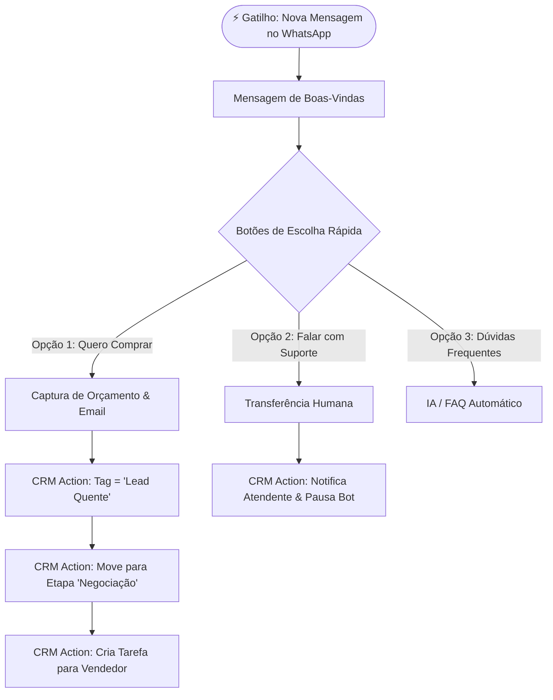

# 🚀 Kommo Brasil Engine — Reverse Engineering & Conversational CRM Architecture

Base de engenharia reversa completa da plataforma **Kommo Brasil** (`kommo.com/br`), contendo a arquitetura de **CRM Conversacional Multi-Canal** (WhatsApp, Instagram, Telegram), **Design System & Tokens** de conversão, e o motor completo da **Árvore de Atendimento Visual (Salesbot Flowchart Builder)** com schemas de execução JSON.

---

## 📂 Estrutura do Repositório

```
kommo-crm-engine/
├── docs/
│   ├── REA_KOMMO_BRASIL.md            # Raio-X completo do SaaS, Copy e Design System
│   └── ARVORE_ATENDIMENTO_SALESBOT.md # Dissecção da Árvore de Decisão e DAG
├── schemas/
│   ├── salesbot-schema.json           # Schema JSON padrão para árvores de atendimento
│   └── default-sales-flow.json        # Exemplo real de fluxo pronto de qualificação comercial
├── src/
│   ├── tokens/
│   │   └── design-tokens.ts           # Cores, tipografia Euclid/Roboto e tokens Tailwind v4
│   └── types/
│       └── salesbot.ts                # Tipagens TypeScript completas para Nós, Gatilhos e Ações
└── README.md
```

---

## 🧠 1. Árvore de Atendimento Visual (Salesbot Engine)

O motor de atendimento da Kommo opera sobre um grafo direcionado com 4 blocos de controle:



### Os 4 Blocos da Árvore:
1. **Triggers (Gatilhos):** Início de conversa via WhatsApp, palavras-chave (`orçamento`, `preço`), ou alteração de etapa no Kanban.
2. **Steps (Nós de Mensagem):** Textos com variáveis dinâmicas (`{{lead.name}}`), áudios realistas e botões de resposta rápida com sinônimos semânticos.
3. **Conditions (Bifurcações Se/Senão):** Checagem de horário de atendimento, validação de e-mail/telefone e faixa de faturamento.
4. **CRM Actions (Ações de Backend):** Criação e movimentação de cards no funil Kanban, atribuição de responsável (Round-Robin), adição de tags e disparos de Webhook.

---

## 🎨 2. Design System & Tokens (Cores & Identidade)

* **Texto Principal:** `#0E0142` (Azul escuro profundo / alto contraste sem a agressividade do preto puro)
* **Acento Primário (Kommo Electric Blue):** `#00A0FF` a `#00D2FF`
* **Conversão / WhatsApp Green:** `#15CF74` e `#2DA771`
* **Backgrounds:** `#FFFFFF` (Base) e `#F8FAFC` (Cards secundários)
* **Tipografia:** `Euclid Circular A` (Heading) e `Roboto / sans-serif` (Body)

---

## 🛠️ Tecnologias Recomendadas para Implementar o Visual Builder

* **Frontend:** Next.js 15 (App Router) + Tailwind CSS v4
* **Canvas Interativo de Nós:** `@xyflow/react` (React Flow)
* **Gerenciamento de Estado:** `Zustand`
* **Execução Assíncrona de Nós:** `Vercel Workflow` ou `BullMQ` + `Redis`
* **Banco de Dados Relacional:** `PostgreSQL` / `Supabase` com RLS

---

## 📄 Licença
Desenvolvido para fins de estudo, engenharia reversa e prototipagem de arquiteturas SaaS avançadas por **Lucas Lavarini**.
