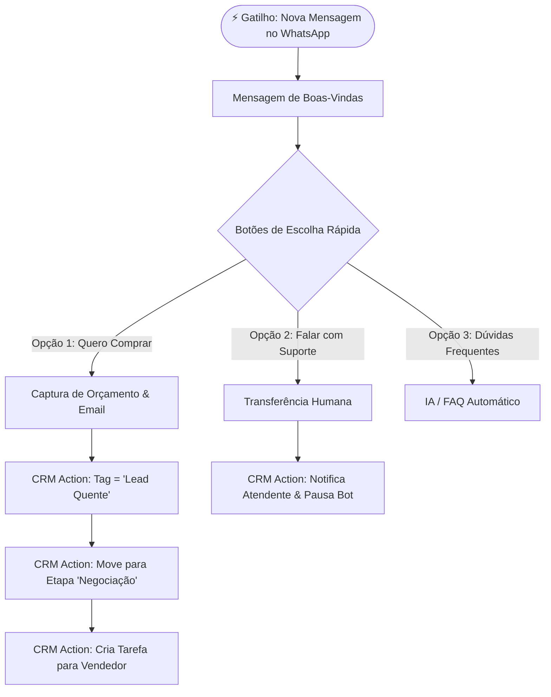

# Engenharia Reversa (REA) — Árvore de Atendimento do Kommo (Salesbot Builder)

**Produto:** Salesbot Visual Builder (Kommo CRM)  
**Conceito:** Motor de Árvore de Decisão Visual com Fluxo Direcionado (DAG - Directed Acyclic Graph) integrado bidirecionalmente com o Pipeline de Vendas e WhatsApp.  
**Objetivo:** Dissecção da arquitetura lógica, nós, gatilhos e schema JSON para replicar como base no seu repositório GitHub.

---

## 1. Arquitetura Conceitual da Árvore (O Motor)

Diferente de chatbots tradicionais de texto que apenas "respondem perguntas", o Salesbot da Kommo é uma **máquina de estados finitos orientada a eventos do CRM**:



---

## 2. Os 4 Blocos Fundamentais da Árvore da Kommo

A árvore do Salesbot é composta estritamente por 4 tipos de blocos:

### ⚡ Bloco 1: Triggers (Gatilhos de Entrada)
Define quando um ramo da árvore é ativado.
* **Gatilhos de Conversa:**
  * Nova conversa iniciada (WhatsApp, Instagram Direct, Telegram, etc.).
  * Palavra-chave exata digitada pelo cliente (ex: *"preço"*, *"orçamento"*, *"suporte"*).
  * Menção nos Stories do Instagram.
* **Gatilhos de Pipeline (CRM):**
  * Lead movido para uma etapa específica no funil Kanban (ex: quando o vendedor arrasta o card para *"Proposta Enviada"*).
* **Gatilhos Temporais (Timer):**
  * Lead sem resposta há mais de X horas (Follow-up automático).

---

### 💬 Bloco 2: Steps (Passos de Interação / Nós Visuais)
São os nós visuais onde a conversa acontece:

1. **Nó de Mensagem (Message Step):**
   * Texto com interpolação de variáveis: `Olá, {{lead.name}}! Como posso ajudar hoje?`
   * Envio de Áudio simulando gravação em tempo real (*"Gravando áudio..."*).
   * Envio de PDFs, imagens e contratos.
2. **Botões de Resposta Rápida (Quick Replies):**
   * Até 13 botões (Kommo recomenda 3 para boa ergonomia mobile).
   * **Sinônimos Semânticos:** Se o botão é `[Orçamento]`, o robô aceita se o cliente digitar `1`, `cotacao`, `valor` ou `quanto custa`.
   * **Botões de Link:** Redirecionamento direto para checkout ou catálogo.
3. **Pausa / Espera (Wait Step):**
   * Delay proposital de 3 a 7 segundos para parecer digitação humana real.
   * Esperar resposta do cliente por até 24 horas antes de acionar a rota de abandono.

---

### 🔀 Bloco 3: Conditions (Condicionais / Ramificações Se/Senão)
A bifurcação lógica da árvore:
* **Validação de Dados:**
  * *O contato já possui e-mail cadastrado?*
    * **Sim:** Avança direto para a proposta.
    * **Não:** Pede o e-mail antes de prosseguir.
* **Validação de Horário de Atendimento:**
  * *Mensagem enviada entre 08h e 18h?*
    * **Sim:** Rota de atendimento comercial imediato.
    * **Não:** Rota de plantão noturno: *"Recebemos seu contato e às 08h nossa equipe te chama!"*.

---

### ⚙️ Bloco 4: CRM Actions (Ações Invisíveis no Backend)
É aqui que a Kommo se diferencia de um bot comum. O bot atua como um operador invisível do CRM:
* **`update_field`:** Salva qualquer dado digitado no chat direto no campo do lead no banco de dados.
* **`add_tag` / `remove_tag`:** Etiqueta o lead (ex: `Hot Lead`, `WhatsApp VIP`, `Inadimplente`).
* **`move_stage`:** Move o card do lead sozinho no Kanban.
* **`assign_responsible`:** Distribui o lead por rodízio (Round-Robin) entre os atendentes da equipe.
* **`webhook_request`:** Dispara uma chamada HTTP POST para sistemas externos (ex: gateway de pagamento, Vercel, Supabase).

---

## 3. Schema JSON para Replicar a Árvore no seu GitHub

Para você implementar essa mesma árvore no seu repositório (React Flow, Next.js ou backend em Node/Python), este é o **schema de dados padronizado** baseado na engenharia da Kommo:

```json
{
  "bot_id": "salesbot_kommo_base_v1",
  "name": "Árvore de Qualificação Comercial",
  "trigger": {
    "type": "incoming_message",
    "channel": "whatsapp",
    "filters": {
      "pipeline_id": "vendas_geral",
      "stage_id": "novo_lead"
    }
  },
  "nodes": [
    {
      "id": "node_1",
      "type": "message",
      "content": "Olá, {{contact.first_name}}! Bem-vindo à nossa empresa. Como podemos acelerar o seu negócio hoje?",
      "options": [
        { "id": "opt_1", "label": "Quero um Orçamento", "next_node": "node_qualify" },
        { "id": "opt_2", "label": "Suporte Técnico", "next_node": "node_support" },
        { "id": "opt_3", "label": "Falar com Vendedor", "next_node": "node_human" }
      ]
    },
    {
      "id": "node_qualify",
      "type": "input_prompt",
      "prompt": "Perfeito! Qual é o faturamento médio mensal da sua empresa hoje?",
      "save_to_field": "lead.faturamento",
      "next_node": "node_condition_budget"
    },
    {
      "id": "node_condition_budget",
      "type": "condition",
      "rules": [
        {
          "field": "lead.faturamento",
          "operator": ">=",
          "value": 10000,
          "next_node": "node_vip_client"
        }
      ],
      "fallback_node": "node_standard_client"
    },
    {
      "id": "node_vip_client",
      "type": "action_group",
      "actions": [
        { "action": "add_tag", "tag": "VIP_ENTERPRISE" },
        { "action": "move_stage", "target_stage": "negociacao_prioritaria" },
        { "action": "assign_responsible", "user_id": "diretor_comercial" },
        { "action": "notify_slack", "channel": "#vendas-vip" }
      ],
      "next_node": "node_farewell_vip"
    }
  ]
}
```

---

## 4. Recomendações de Bibliotecas para o seu GitHub

Se você for construir a interface visual dessa árvore igual à Kommo no Next.js:
1. **Frontend do Builder:** Use **`@xyflow/react`** (antigo **React Flow**) — é a biblioteca padrão da indústria para criar nós, caixas arrastáveis e conexões com setas bezier idênticas ao Salesbot.
2. **Estado do Canvas:** **`Zustand`** para manipular a criação e conexão de nós com altíssima performance.
3. **Execução de Nós no Backend:** Uma máquina de estados simples com fila de eventos (como **BullMQ** ou **Vercel Workflow**).
